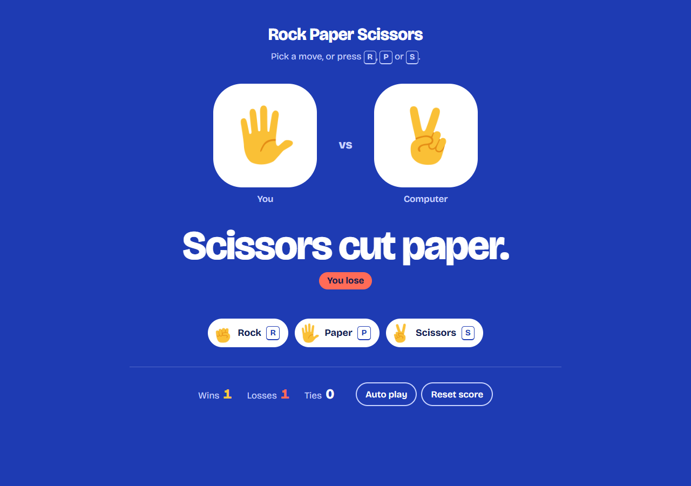

# Rock Paper Scissors Game ⛰️✂️📜

A simple, interactive **Rock Paper Scissors** game against the computer, written in plain **JavaScript**, **HTML** and **CSS**, with no build step and no dependencies.



---

## 🚀 Features

- **Manual Play**: Choose Rock, Paper or Scissors to play against the computer. The result shows the rule that settled the round, for example "Paper covers rock."
- **Auto-Play Mode**: The game plays itself every second until you stop it.
- **Score Tracking**: Wins, losses and ties are kept in `localStorage`, so they survive a page refresh.
- **Keyboard Shortcuts**:
  - Press **R** for Rock
  - Press **P** for Paper
  - Press **S** for Scissors

  Browser shortcuts such as Ctrl+R (reload) and Ctrl+P (print) are left alone.
- **Reset Score**: A button that sets the score back to zero and clears the saved data.
- **Works anywhere**: on phones and desktops, with the keyboard, and with screen readers, which announce each result.

## ▶️ Play

Open `index.html` in a browser. Double-clicking the file works; no server is needed.

## 🗂️ Project layout

```
index.html        the page
styles.css        the look
src/game.js       the rules: outcomes, the computer's move, the score (no page code, so it can be tested)
src/main.js       the page behaviour: buttons, shortcuts, auto play, saving the score
images/           the hand pictures
test/             tests for the rules
```

## ✅ Tests

The rules are tested with Node's built-in test runner (Node 18 or newer, nothing to install):

```
npm test
```

The tests also run on GitHub for every push and pull request.

## 📄 License

GPL-3.0. See [LICENSE](LICENSE).
